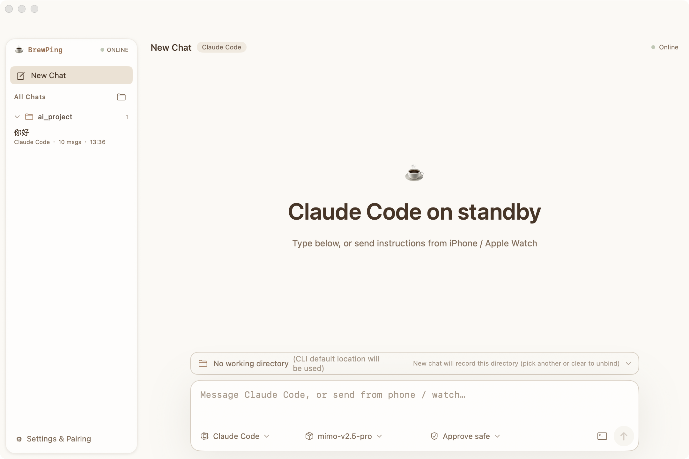
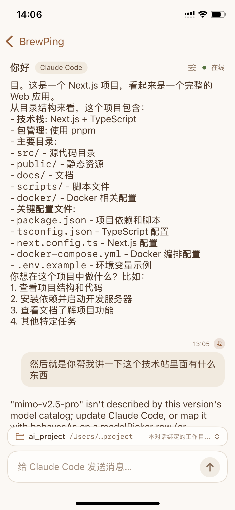
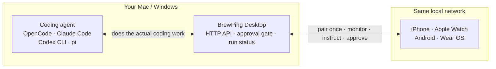

# BrewPing

> English | [简体中文](README.zh-CN.md)

<p align="center">
  <a href="https://www.commitbrew.com">
    
  </a>
</p>

**A local-network remote control for coding agents running on your own computer.**

BrewPing lets you monitor, control, and approve coding-agent tasks running on your own Mac or Windows
computer — from your iPhone, Apple Watch, or Android phone. Pair once over your local network, and the
work stays on your machine: no account, no analytics, no server of ours in the path.

*Your agents, your models, your machine — driven from your phone, on your own network.*

<div align="center">

[](https://github.com/banmu123/BrewPing/actions/workflows/ci.yml)

[](LICENSE)

[](https://github.com/banmu123/BrewPing/stargazers)

[](https://apps.apple.com/us/app/brewping/id6812269598)


</div>

The `CI` badge points to [`.github/workflows/ci.yml`](.github/workflows/ci.yml): five jobs — Swift
core, iOS + watchOS compile, Windows Rust, Android and repository hygiene — run on **every push and
pull request**, plus a nightly run to catch runner toolchain drift. This is a real
test-on-every-push CI, not a packaging-only workflow.

> **Which version is this README about?** It describes `main`. The App Store build (listing shows
> **v1.1**, free, released 2026-10-29 — minimum iOS 18.6), the `v1.0.0` desktop installers, and the
> Android / Wear OS sources are **not the same snapshot**: iOS, watchOS, macOS and Windows are
> shipped; Android and Wear OS are not; the experimental relay path is disabled and its iPhone
> entry point is not exposed. The dated, canonical record is
> [Platform status](#-platform-status) and [docs/PROJECT\_STATUS.md](docs/PROJECT_STATUS.md).

## ⬇️ Download

| Platform | Get it |
|---|---|
| **iPhone / Apple Watch** | **[Download on the App Store](https://apps.apple.com/us/app/brewping/id6812269598)** |
| **macOS** | [GitHub Release](https://github.com/banmu123/BrewPing/releases/tag/v1.0.0) — signed & notarized DMG · or the [download page](https://www.commitbrew.com/#download) |
| **Windows** | [GitHub Release](https://github.com/banmu123/BrewPing/releases/tag/v1.0.0) — `setup.exe` / `.msi` |
| **Android** | Build from source — `cd Android && ./gradlew assembleDebug` · **no public installer** |
| **Wear OS** | No artifact. The `:wear` module builds in CI but has never been through device testing or store submission. |
| **Source** | `git clone https://github.com/banmu123/BrewPing.git` |

The macOS and Windows builds on the release page are the same code as this repository at tag `v1.0.0`.
The Android and Wear OS rows are source builds, not download links we cannot stand behind. Which
surfaces are shipped, in-repo-but-unreleased, or not started is summarised in
[Platform status](#-platform-status); the canonical table — with requirements, test counts, and known
limitations — is [docs/PROJECT_STATUS.md](docs/PROJECT_STATUS.md).

## 📸 Screenshots

<p align="center">
  
  
</p>
<p align="center">
  <sub><b>macOS desktop</b> &nbsp;·&nbsp; <b>iPhone</b> — product imagery for the shipped desktop / iOS interface</sub>
</p>

These two frames show the **shipped desktop and iPhone clients**. The Apple Watch app, the Windows
desktop and the Android / Wear OS clients are not pictured; the latter two are not distributed at all.
Both images live in [`docs/screenshots/`](docs/screenshots/) and are the only screenshots kept as
product imagery.

## What BrewPing is — and what it is not

**BrewPing is not a coding agent.** It does not write code, it does not call a model on your behalf,
and it does not replace the tools you already use.

It is a **remote interface for coding agents that are already running on your own computer**. The
agent does the actual work; BrewPing is how you watch it, steer it, and approve what it is about to do
— without sitting at that machine.



Android and Wear OS appear here because the client modules exist in the repository; they are
**not distributed**. BrewPing ships no agent and no model. It detects the CLI agents you installed,
reads the configuration they already have, and drives them exactly as they are — your subscriptions,
credentials, and settings stay where they are.

**Not in scope:** a hosted service or an official public relay, replacing your agent's configuration,
running models in the cloud, or treating the approval gate as a sandbox around the agent.

## 🎯 Who is it for?

- You run a coding agent — OpenCode, Claude Code, Codex CLI, or pi — on a Mac or Windows machine, and
  you want to kick off work, check progress, or approve a risky command **without sitting at that
  machine**.
- You want that from your **phone or watch**: one hand, one glance, no remote desktop.
- You care that your code, prompts, and agent output **stay on your own machines**.

**Not for you if:** you don't have any of those CLI agents installed (BrewPing drives them, it does
not replace them), or you are looking for a hosted coding agent that runs in the cloud.

## 🤔 Why BrewPing instead of SSH, remote desktop, or a hosted agent?

| | SSH / terminal apps | Remote desktop | Hosted coding agents | **BrewPing** |
|---|---|---|---|---|
| Agent-aware UI (status, transcripts, models) | ✗ | ✗ | ✓ | ✓ |
| Usable on a phone / watch | awkward | screen-shaped | ✓ | ✓ (native apps) |
| Keeps your existing agent config & logins | ✓ | ✓ | ✗ | ✓ (reads them, never replaces them) |
| Approval gate before risky commands run | ✗ | ✗ | varies | ✓ (safe / ask-all / auto) |
| Your code and prompts stay on your machines | ✓ | ✓ | usually not | ✓ (local network only) |
| Works with several agents + model switching | ✗ | ✗ | ✗ | ✓ |

## ✨ Features

Everything below describes the **shipped** iOS / watchOS / macOS / Windows builds. The Android phone
app and the Wear OS module exist in `main` and are covered by CI, but are **not distributed**; the
experimental relay path is disabled and its iPhone entry point is not exposed.

### 📡 Monitor & control

- **Remote monitoring** — live agent status and streaming output, rendered as Markdown, on your phone
  or watch.
- **Remote control** — start and stop sessions, send instructions, switch the active agent and model.
- **Authoritative run status** — the desktop derives the execution phase
  (`queued` / `thinking` / `streaming` / `stalled` / `completed` / `failed`); clients display it and
  never guess whether a run is stuck.

### 🛡 Approval gate

- **Dangerous commands are held** until you approve them; a pending request times out as *denied*,
  never as approved.
- **Three levels** — safe / ask-all / auto, fixed per conversation. This is a guard for **your**
  instructions, not isolation for the agent: a shell command the agent spawns on its own is not
  covered.

### 💬 Conversations & working folders

- **Conversations are bound to a folder**, so file operations happen where the conversation lives.
- **Per-conversation settings** — agent, model, and approval level are set **per conversation**, not
  globally.

### 📱 Clients

- **iPhone and Apple Watch** — the Watch app takes voice-dictated instructions and shows the reply.
- **Android (in repository, not distributed)** — the phone app shares the same flow; the Wear OS
  module builds in CI but has no store release.
- **Multi-device** — pair several computers and switch between them from the device bar.
- **Bilingual UI** — English and Simplified Chinese, switchable in-app without a restart.

### 🖥 Desktop, agents & local-first

- **Four agents, one interface** — OpenCode, Claude Code, Codex CLI, and pi, with per-agent model
  switching ([details](#-supported-coding-agents)).
- **Automatic discovery** — Bonjour/mDNS finds computers on the current Wi-Fi; manual host and port is
  always available as a fallback.
- **Local-first** — commands and output travel only between your phone and the computer you paired.
- **No account, no sign-up** — pairing is a one-time 6-digit code, not a login.

## 🔄 How it works

Four boundaries are worth keeping separate:

| Boundary | What crosses it | How |
|---|---|---|
| **On the computer** | Your code, prompts, agent output and transcripts | The agent process is supervised by BrewPing Desktop; none of it is uploaded anywhere. |
| **Local network** | Instructions, approval decisions, streaming output | Plain HTTP on the LAN. Bearer token on every call; writes also carry a timestamp and nonce (120-second replay window). |
| **Pairing** | One-time 6-digit code → long-lived token | Single use, 10-minute expiry. Token lives in the iPhone Keychain / `~/.brewping/pairing.json` (`0600`). |
| **Cross-network (not shipped)** | Nothing by default | No official relay. If you need it, that is a network setup on your side — for example a VPN overlay such as Tailscale or WireGuard. |

```
┌──────────────────────────────────────┐
│          Your Mac / Windows          │
│                                      │
│   Coding agent                       │
│   OpenCode · Claude Code ·           │
│   Codex CLI · pi                     │
│              │                       │
│        BrewPing Desktop              │
└──────────────┼───────────────────────┘
               │   local network
               │   HTTP API + Bonjour/mDNS discovery
        ┌──────┴───────┐
        │              │
     iPhone        Apple Watch
        │              │
   monitor · control · approve
```

1. Your agent runs on your computer, exactly as it does today.
2. BrewPing Desktop sits next to it, exposes a local HTTP API, and supervises the agent process.
3. Your phone or watch discovers the computer on the same network and pairs with a one-time code.
4. From there you monitor, instruct, and approve — the network never leaves your LAN.

**Local-first is not the same as encrypted.** The LAN leg is **plaintext HTTP**: the bearer token,
timestamp and nonce authenticate requests and prevent replay, but they do **not** encrypt the
payload. Treat pairing as something to do on a network you trust. A TLS design exists in
[Secure transport plan](docs/design/BrewPing-安全传输方案.md); it is a proposal, not shipped.

## 📦 Platform status

| Platform | Status | Notes |
|---|---|---|
| **iOS** | **Available** — [App Store](https://apps.apple.com/us/app/brewping/id6812269598) | iPhone only |
| **watchOS** | **Available** — App Store | Ships with the iPhone app; voice-dictated instructions, swipe to switch agent/model |
| **macOS** | **Available** — GitHub Release `v1.0.0` | Universal binary (Apple Silicon + Intel), Developer ID signed, notarized, stapled |
| **Windows** | **Available** — GitHub Release `v1.0.0` | Tauri 2 desktop; `setup.exe` / `.msi`; needs WebView2 |
| **Android** | **Built, not published** | Builds from this repository; not submitted to Google Play |
| **Wear OS** | **In the repository, not released** | `Android/wear` builds and is covered by CI; no device testing, no store submission |
| **Cross-network** | **Not supported** | Local network only — no hosted service and no official public relay |

Minimum OS versions, test counts, and CI jobs: **[PROJECT_STATUS.md §2–§3](docs/PROJECT_STATUS.md)**.

"Built" means the artifact can be produced from this repository. It does **not** mean it is available
to the public. Anything not listed as *Available* above is not shipped.

## 🧠 Supported coding agents

BrewPing drives CLI agents **you installed yourself**. It never bundles or redistributes them, and it
never replaces their configuration — it reads what is there.

| Agent | Mode | Command | Configuration read from |
|-------|------|---------|-------------------------|
| OpenCode | Session (interactive PTY) | `opencode` | `~/.config/opencode/opencode.json` |
| Claude Code | Headless (one-shot) | `claude` | `~/.claude/settings.json` |
| Codex CLI | Headless (one-shot) | `codex` | `~/.codex/config.toml` |
| pi | Headless (one-shot) | `pi` | `~/.pi/agent/settings.json` + `~/.pi/agent/models.json` |

Install the ones you want to use:

```bash
# OpenCode
curl -fsSL https://get.opencode.ai | sh

# Claude Code
npm install -g @anthropic-ai/claude-code

# Codex CLI
npm install -g @openai/codex

# pi
npm install -g @earendil-works/pi-coding-agent
```

Product names and trademarks belong to their respective owners — see [TRADEMARKS.md](TRADEMARKS.md).

## 🚀 Getting started

### 1. Install BrewPing Desktop

- **macOS** — download the DMG from the [GitHub Release](https://github.com/banmu123/BrewPing/releases/tag/v1.0.0)
  (or the [download page](https://www.commitbrew.com/#download)), open it, and drag **BrewPing Desktop**
  into Applications. It is signed, notarized, and stapled, so Gatekeeper opens it without warnings.
- **Windows** — download `setup.exe` or the `.msi` from the same release and install it.
- **From source (macOS)**:

  ```bash
  git clone https://github.com/banmu123/BrewPing.git
  cd BrewPing
  ./build-app.sh                          # produces build/BrewPing Desktop.app
  open "build/BrewPing Desktop.app"
  ```

### 2. Install the phone app

- **iPhone / Apple Watch** — install **BrewPing** from the [App Store](https://apps.apple.com/us/app/brewping/id6812269598).
- **Android** — build and install from source:

  ```bash
  cd Android && ./gradlew assembleDebug   # Windows: gradlew.bat assembleDebug
  ```

### 3. Pair your phone

1. In BrewPing Desktop, open **Show Pairing Code** — a 6-digit code and a QR code appear.
2. On your phone, scan the QR code, or tap **Add Device** and type the code.
3. Both devices must be on the **same local network**.

The pairing code is single-use and expires after 10 minutes. Full setup detail, including manual
host/port entry when multicast is blocked, is in [docs/](docs/) and [CONTRIBUTING.md](CONTRIBUTING.md).

### 4. Point it at an agent

BrewPing lists the agents it found on the computer. Pick one, choose a working folder, and send your
first instruction — you can switch agent and model at any time, per conversation.

### ⌨️ Use BrewPing from the CLI

```bash
swift run BrewPing start                        # start an OpenCode session in a PTY
swift run BrewPing status                       # show the current session status
swift run BrewPing send "Fix the failing test"  # send a message to the session
swift run BrewPing attach                       # attach to the running session (Ctrl+D to detach)
swift run BrewPing stop                         # stop the session
```

## 🔒 Privacy & security

- **Local network only.** No account, no analytics, no third-party SDKs, and no server operated by us
  is in the request path. Commands, agent output, and transcribed speech travel only between your
  phone (or watch) and the computer you paired. Full text: [privacy policy](docs/privacy.html).
- **The LAN leg is plaintext HTTP.** There is no TLS yet. Bearer tokens, timestamps and nonces
  authenticate requests and prevent replay; they do **not** encrypt the payload. Treat pairing and
  daily use as something to do on a network you trust.
- **Pairing, not login.** A one-time 6-digit code (single use, 10-minute expiry) is exchanged for a
  long-lived token. Every `/api/*` request carries `Authorization: Bearer <token>`; writes also carry
  `X-BrewPing-Timestamp` and `X-BrewPing-Nonce`, giving a 120-second replay-protected window.
- **The token is equivalent to command execution on that machine.** It is stored with `0600`
  permissions on the desktop (`~/.brewping/pairing.json`) and in the iPhone Keychain.
- **The approval gate is a safety net, not a sandbox.** It intercepts commands at the point they enter
  the agent. A shell command the agent spawns on its own is *not* covered. Treat it as a guard for
  **your** instructions, not as isolation for the agent.
- **Cross-network access is your own call.** BrewPing does not operate, configure, or endorse a relay;
  if you need it, that is a network problem you solve on your side (for example with a VPN overlay such
  as Tailscale or WireGuard).

Local state lives in `~/.brewping/`: `device.json` (identity), `pairing.json` (token, `0600`),
`approval.json` (approval mode and always-allow rules, `0600`), `config.json` (agent and model
preferences), `session.json` (current session).

See [SECURITY.md](SECURITY.md) for the full security model and what is explicitly out of scope.

*"Local-first" describes where your data lives and who controls it. It is not a promise that the link
is encrypted.*

## 🏗️ Architecture

- **Desktop service** — a Swift core (`Sources/App`, `Sources/Agents`, `Sources/PTY`,
  `Sources/Session`, `Sources/Protocol`, Swift 5.9 / SwiftPM, no third-party Swift dependencies). It
  exposes an HTTP API on your LAN, supervises agent processes, and gates commands through the approval
  check. The Windows build reimplements the same API surface in Rust (Tauri 2 + axum + React) and is
  covered by the same clients.
- **Clients** — iOS and watchOS (SwiftUI + WatchConnectivity), Android (Kotlin + Jetpack Compose), and
  a CLI (`swift run BrewPing …`). Clients never talk to each other, and never to a machine you did not
  pair.
- **Discovery** — Bonjour/mDNS on the local network, with manual host and port as a fallback.
- **Transport & auth** — HTTP on the LAN; a bearer token on every call, plus timestamp and nonce on
  writes.
- **Run status** — the desktop derives the authoritative execution phase for a command
  (`queued` / `thinking` / `streaming` / `stalled` / `completed` / `failed`) and serves it through the
  API. Clients display it; they never guess whether a run is stuck.
- **HTTP API** — `POST /api/pair` and `GET /api/status` are public; everything else needs the bearer
  token. Endpoints cover agents (`/api/agents…`), messages and run status (`/api/message…`), sessions
  (`/api/session…`), approvals (`/api/approvals…`), conversations (`/api/conversations…`), and
  folders (`/api/folders…`).

```
Sources/
├── App/                  # HTTP API, routing, pairing store, approval gate, conversations
├── Agents/               # agent discovery + OpenCode / Claude Code / Codex / pi drivers
├── PTY/                  # pseudo-terminal handling for interactive agents
├── Session/              # session lifecycle
├── Protocol/             # wire protocol shared by every client
├── BrewPing/             # CLI entry point (start / status / send / attach / stop)
├── BrewPingDesktop/      # macOS SwiftUI app (window + menu bar)
└── BrewPingwinDesktop/   # Windows desktop (Tauri 2 + axum + React)
ios/                      # iPhone app + Apple Watch app
Android/                  # Android phone app + Wear OS module
Scripts/                  # packaging (build-mac-app.sh) + entitlement/Info.plist for the DMG
docs/                     # canonical status, design notes, audit records, privacy policy
```

## 📚 Documentation

Objective state — platform requirements, distribution status, test counts, known limitations — lives
in **[Project status](docs/PROJECT_STATUS.md)** and nowhere else. Everything else is here:

| Topic | Document |
|---|---|
| **Project status (authoritative)** | [docs/PROJECT_STATUS.md](docs/PROJECT_STATUS.md) |
| **Documentation map** | [docs/OVERVIEW.md](docs/OVERVIEW.md) |
| **Privacy policy** | [docs/privacy.html](docs/privacy.html) |
| **Security model** | [SECURITY.md](SECURITY.md) |
| **Contributing guide** | [CONTRIBUTING.md](CONTRIBUTING.md) |
| **Roadmap** | [ROADMAP.md](ROADMAP.md) |
| **Trademarks** | [TRADEMARKS.md](TRADEMARKS.md) |
| iOS structure & modules | [docs/design/BrewPing-iOS端结构与模块划分.md](docs/design/BrewPing-iOS端结构与模块划分.md) |
| Windows multi-conversation design | [docs/design/BrewPing-Windows端多对话管理实现方案.md](docs/design/BrewPing-Windows端多对话管理实现方案.md) |
| Provider management | [docs/design/BrewPing-Provider管理-Lody新建Provider迁移方案.md](docs/design/BrewPing-Provider管理-Lody新建Provider迁移方案.md) |
| Folder browsing | [docs/design/BrewPing-获取文件夹-Windows落地方案.md](docs/design/BrewPing-获取文件夹-Windows落地方案.md) |
| Wear OS preparation checklist | [docs/design/BrewPing-WearOS端开发准备清单.md](docs/design/BrewPing-WearOS端开发准备清单.md) |
| Secure transport plan (proposal) | [docs/design/BrewPing-安全传输方案.md](docs/design/BrewPing-安全传输方案.md) |
| Per-device authorization plan (proposal) | [docs/design/BrewPing-设备授权与撤销方案.md](docs/design/BrewPing-设备授权与撤销方案.md) |
| Security audit (batch 2) | [docs/audits/BrewPing-安全审计-第二批.md](docs/audits/BrewPing-安全审计-第二批.md) |
| Code review (Phase 1) | [docs/audits/BrewPing-代码审查-Phase1-审计.md](docs/audits/BrewPing-代码审查-Phase1-审计.md) |
| Android ↔ iOS feature parity audit | [docs/audits/BrewPing-Android-iOS-功能对齐审查.md](docs/audits/BrewPing-Android-iOS-功能对齐审查.md) |
| App Store pre-submission review | [docs/audits/AppStore-PreSubmission-Review.md](docs/audits/AppStore-PreSubmission-Review.md) |
| TestFlight validation report | [docs/audits/TestFlight-Validation-Report.md](docs/audits/TestFlight-Validation-Report.md) |
| TestFlight auto-discovery diagnosis | [docs/audits/BrewPing-iOS-TestFlight-自动发现-诊断.md](docs/audits/BrewPing-iOS-TestFlight-自动发现-诊断.md) |
| Screenshots | [docs/screenshots/](docs/screenshots/) |

## 🤝 Development & contributing

**Requirements:** macOS with Xcode for the Swift core and the iOS / watchOS targets; a Rust toolchain
for the Windows desktop (Tauri 2 + axum); JDK 17 + Android SDK platform 36 for the Android modules;
Node for the Windows frontend.

```bash
# Swift core — build + tests (macOS)
swift build --disable-sandbox
swift test --disable-sandbox

# iOS / watchOS — compile with signing disabled
xcodebuild -project ios/BrewPing.xcodeproj -scheme BrewPing \
  -destination 'generic/platform=iOS' CODE_SIGNING_ALLOWED=NO build
xcodebuild -project ios/BrewPing.xcodeproj -scheme 'BrewPing Watch App' \
  -destination 'generic/platform=watchOS' CODE_SIGNING_ALLOWED=NO build

# Windows desktop — Rust tests + frontend typecheck (from repo root)
(cd Sources/BrewPingwinDesktop/src-tauri && cargo test --locked)
(cd Sources/BrewPingwinDesktop && npx tsc)

# Android — JVM tests + phone / Wear builds
(cd Android && ./gradlew test assembleDebug :wear:assembleDebug)

# Localization — verify the en / zh string tables
python3 ios/Scripts/check_localization.py
```

Sanity check before opening a PR — every suite runs without a device or emulator. Current counts per
suite are recorded in [PROJECT_STATUS.md §3](docs/PROJECT_STATUS.md#3-test--ci-status) and are
deliberately not duplicated here.

**CI today:** [`.github/workflows/ci.yml`](.github/workflows/ci.yml) runs all of the above plus
repository-hygiene checks on every push and pull request, with a nightly schedule to catch runner
toolchain drift. Five jobs, all on public runners.

**Contributing:** issues and pull requests are welcome. Build commands, CI expectations, and repository
conventions live in **[CONTRIBUTING.md](CONTRIBUTING.md)**; security reports go through
**[SECURITY.md](SECURITY.md)**. Localised user-facing strings must go through `L()` (iOS) / the
Android string tables, with both languages kept in sync.

## 🗺️ Roadmap

Direction, not commitments.

**Already shipped:** iPhone + Apple Watch on the App Store; macOS and Windows desktop at `v1.0.0`;
four agent integrations; the approval gate; conversations with working folders, per-conversation
agent / model / approval settings; Bonjour discovery; bilingual UI; the CLI; and CI on every push.

**In progress**
- **More agent integrations.** The agent catalog is built to be extended beyond the four supported today.
- **Wear OS client.** The module is in the repository and builds in CI, but it is not released and has
  not been through device testing or store submission.
- **Smoother multi-device workflows.** Pairing several computers works today; per-device context and
  faster switching are the next step.

**Planned (proposals, not shipped)**
- [Secure transport](docs/design/BrewPing-安全传输方案.md) — TLS for the LAN leg, with pairing-bound
  certificate pinning.
- [Per-device credentials & revocation](docs/design/BrewPing-设备授权与撤销方案.md) — one revocable
  credential per paired device, with a managed-device list.

**Not planned:** a hosted service or an official public relay. Cross-network access stays a user-side
network setup.

## ⚠️ Trademarks

OpenCode, Claude, Claude Code, Codex, and pi are trademarks of their respective owners. BrewPing is
not affiliated with, endorsed by, or sponsored by them; these names appear only to describe
compatibility — see **[TRADEMARKS.md](TRADEMARKS.md)** for the per-name list.

## 📄 License

[MIT](LICENSE).

BrewPing does not bundle or redistribute any third-party agent. It only detects and runs the
command-line tools you have already installed on your own computer.

## 🙏 Credits

- [Swift](https://www.swift.org/) + SwiftUI / AppKit / Network.framework — the core service and the macOS app
- [Tauri](https://tauri.app/), Rust and [axum](https://github.com/tokio-rs/axum) — the Windows desktop shell and HTTP API
- [Jetpack Compose](https://developer.android.com/jetpack/compose) — the Android app
- [shields.io](https://shields.io/) — README badges
- OpenCode, Claude Code, Codex CLI and pi — the agents BrewPing drives (unofficial, see Trademarks)

BrewPing ships no agent binary and no model; the CLI tools it drives remain yours, installed and
configured on your own machine.
